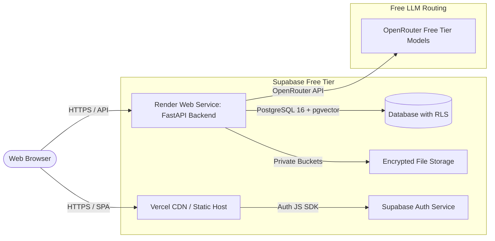

# Deployment and Operations Guide

This guide describes how to run and deploy **Enterprise Knowledge AI** on free-tier infrastructure (Render, Supabase, Vercel) while strictly observing operational constraints and security requirements.

---

## 1. Production Architecture Topology



---

## 2. Infrastructure Configuration & Limits

| Component | Target Platform | Free Tier Quota / Configuration | Operational Countermeasure |
|---|---|---|---|
| **API Backend** | Render Web Service (Python 3.13) | 512MB RAM, sleeps after 15 min inactivity | Local FastEmbed model pre-cached in build stage; lightweight footprint |
| **Database** | Supabase PostgreSQL 16 | 500MB storage, 60 max connections pooler | Connection pool capped at 3 (`max_connections=3`); Session pooler on port 5432 |
| **Storage** | Supabase Storage | 1GB file storage limit | Uploads capped at 5MB per file; max 25 docs per user |
| **Inference** | OpenRouter Free Models | 20 requests/minute community limit | Fallback cascade (`gemma-4-31b-it:free` -> `gemma-4-26b-a4b-it:free` -> `nemotron-3.5-lightning:free` -> `liquid/lfm-2.5-2.6b:free`) |
| **Demo Quota** | PostgreSQL usage counter | 40 requests per UTC day | Shared budget counter returns HTTP 429 with reset time before contacting LLM |

---

## 3. Step-by-Step Supabase Project Setup

1. **Create Supabase Project:**
   - In Supabase Dashboard, create a new project with PostgreSQL 16.
   - Note the project reference ID and database password.

2. **Execute Database Migrations:**
   Run migrations sequentially using the database session pooler connection string:
   ```bash
   psql "postgresql://postgres.<project-ref>:<password>@aws-0-<region>.pooler.supabase.com:5432/postgres" -f supabase/migrations/0001_extensions_and_schema.sql
   psql "postgresql://postgres.<project-ref>:<password>@aws-0-<region>.pooler.supabase.com:5432/postgres" -f supabase/migrations/0002_indexes_and_search.sql
   psql "postgresql://postgres.<project-ref>:<password>@aws-0-<region>.pooler.supabase.com:5432/postgres" -f supabase/migrations/0003_storage_policies.sql
   ```

3. **Verify Row-Level Security (RLS):**
   - Confirm RLS is enabled on `documents`, `document_chunks`, `feedback`, and `daily_usage_counters`.
   - Verify that requests from the Supabase Data API using the anon key return 0 rows.

4. **Create Private Storage Bucket:**
   - Navigate to **Storage** -> **New Bucket**.
   - Bucket Name: `source-documents`
   - Public Bucket: **Disabled** (Private).
   - Allowed MIME types: `application/pdf`, `text/plain`, `text/markdown`, `application/vnd.openxmlformats-officedocument.wordprocessingml.document`.
   - File size limit: 5MB.

5. **Configure Authentication:**
   - Under **Authentication** -> **Providers** -> **Email**:
     - Set signup mode to **Invite Only** (disable "Enable Email Signup") to prevent public spam.
     - Configure Site URL (e.g., `https://your-frontend.vercel.app`) and Redirect URLs.

---

## 4. Environment Variables Reference

### Backend Configuration (`backend/.env`)

```bash
# Environment Mode
ENVIRONMENT=production
LOG_LEVEL=INFO

# PostgreSQL Connection (Use Supabase Session Pooler on Port 5432)
DATABASE_URL=postgresql+psycopg://postgres.<project-ref>:<password>@aws-0-<region>.pooler.supabase.com:5432/postgres

# Supabase Credentials
SUPABASE_URL=https://<project-ref>.supabase.co
SUPABASE_PUBLISHABLE_KEY=<your-supabase-publishable-or-anon-key>
SUPABASE_SECRET_KEY=<your-supabase-service-role-key>
SUPABASE_STORAGE_BUCKET=source-documents

# OpenRouter Free LLM Configuration
OPENROUTER_API_KEY=sk-or-v1-...
OPENROUTER_MODELS=google/gemma-4-31b-it:free,google/gemma-4-26b-a4b-it:free,nvidia/nemotron-3.5-lightning:free,liquid/lfm-2.5-2.6b:free
OPENROUTER_APP_TITLE=Enterprise Knowledge AI
OPENROUTER_APP_URL=https://your-frontend.vercel.app
OPENROUTER_TIMEOUT_SECONDS=45
OPENROUTER_MAX_RETRIES=1
OPENROUTER_REASONING_EFFORT=low
ALLOW_PAID_MODEL=false

# Usage and Rate Limits
LLM_DAILY_REQUEST_BUDGET=40
CHAT_RATE_LIMIT_PER_MINUTE=10
UPLOAD_RATE_LIMIT_PER_MINUTE=3
MAX_DOCUMENTS_PER_USER=25
MAX_UPLOAD_MB=5
MIN_RETRIEVAL_SIMILARITY=0.50

# Evidence Sufficiency Thresholds (Defaults)
# EVIDENCE_LOW_KW_THRESHOLD=0.15
# EVIDENCE_LOW_KW_MIN_SIMILARITY=0.72
# EVIDENCE_SUBCRITICAL_SIMILARITY=0.63
# EVIDENCE_SUBCRITICAL_MIN_KW=0.50
# EVIDENCE_SCORE_GAP_CEILING=0.65
# EVIDENCE_SCORE_GAP_MIN=0.05

# CORS Allowed Origins
CORS_ALLOWED_ORIGINS=https://your-frontend.vercel.app,http://localhost:5173
```

### Frontend Configuration (`frontend/.env`)

```bash
# Backend REST API URL
VITE_API_BASE_URL=https://<your-backend-service>.onrender.com/api/v1

# Supabase Auth Configuration (Public Anon Key ONLY)
VITE_SUPABASE_URL=https://<project-ref>.supabase.co
VITE_SUPABASE_ANON_KEY=<your-supabase-anon-key>
```

> **Security Rule:** Never put `SUPABASE_SECRET_KEY` or `OPENROUTER_API_KEY` into frontend environment files.

---

## 5. Cold-Start Mitigation & Health Probes

1. **Pre-Cache ONNX Weights in Container Build:**
   ```bash
   python -c "from fastembed import TextEmbedding; TextEmbedding(model_name='BAAI/bge-small-en-v1.5', cache_dir='.fastembed_cache')"
   ```

2. **Configure Health Probes on Render:**
   - **Liveness Probe:** `/api/v1/health/live` (Checks FastAPI process availability)
   - **Readiness Probe:** `/api/v1/health/ready` (Validates database connection readiness)

3. **Supabase & Backend Keep-Alive Workflow:**
   - `.github/workflows/keepalive.yml` runs every Monday and Thursday to ping Supabase REST and backend readiness probes, preventing project pause due to inactivity.

---

## 6. Cost Statement & Known Limitations

- **Cost Statement:** Designed for free tiers; actual availability and quotas depend on provider terms and usage. An optional small credit balance on OpenRouter can raise rate limits and stability without altering code architecture.
- **Single-Turn Chat:** Multi-turn conversational memory is omitted to prevent session-drift and context window exhaustion on free models.
- **Community Free-Tier LLMs:** OpenRouter free models may fluctuate in latency and availability. The automated 4-model fallback cascade mitigates provider outages.
